<p align="center">
  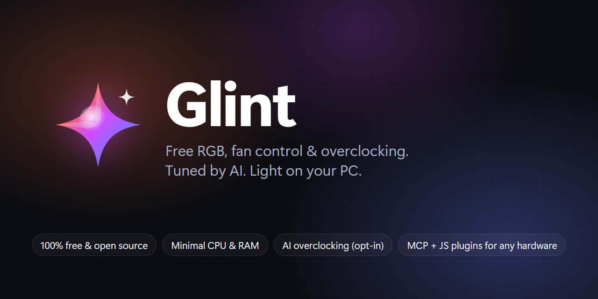
</p>

<p align="center">
  <b>Free, open-source RGB lighting, fan control and hardware monitoring for Windows.</b><br>
  Tiny footprint. AI-ready. Add support for your own hardware with a single JavaScript file.
</p>

<p align="center">
  <a href="LICENSE"></a>
  
  
  
</p>

---

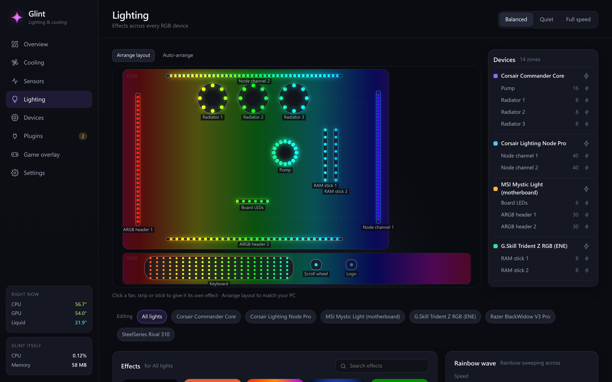

## Why Glint

- **Free, forever.** GPL-3.0, no accounts, no cloud, no telemetry, no paid tier. (The only network requests are an
  optional update check you can switch off, and downloading an update when you install one.)
- **Light.** One small tray process. No Electron, no always-on browser: the dashboard only exists while it's
  open. Effects are rendered once per frame and devices are only written when their colours change.
- **Fans that think about the whole PC.** Every fan curve can take several sensors at once: CPU, GPU, liquid,
  drives, anything. The hottest one wins (or average / weighted). Radiators can follow the GPU and the CPU.
- **Lighting like a pro suite.** 18 built-in effects painted across a 2D layout of your PC, per-device and
  per-fan overrides, presets, audio-reactive and temperature-reactive effects, and effect plugins.
- **AI-native.** A built-in **MCP server** and CLI let an AI agent read sensors, tune fan curves, change lighting
  and even **write and test a plugin for your device**.
- **Extensible by anyone.** Devices and effects are single-file JavaScript plugins in a sandbox, with built-in
  tests against simulated hardware so you can add a device without risking it.
- **Plays well with others.** Home Assistant (MQTT discovery), a HWMonitor-style sensor view, a game overlay, and an
  optional **OpenRGB bridge** for devices Glint doesn't support yet.
- **Tells you what's wrong.** A **Setup check** page finds missing drivers, missing admin rights and other RGB apps
  fighting over your hardware, and offers the fix.

## Features

| | |
|---|---|
| 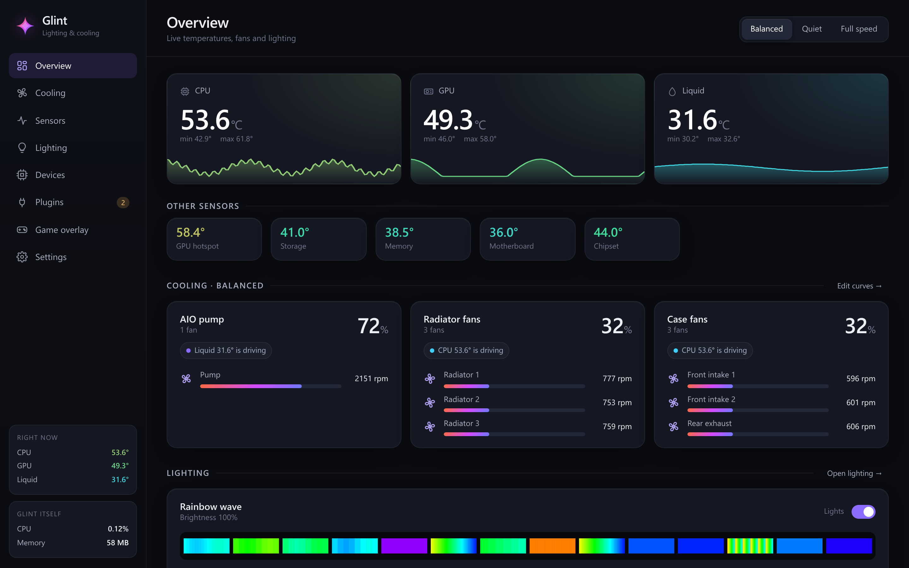 | 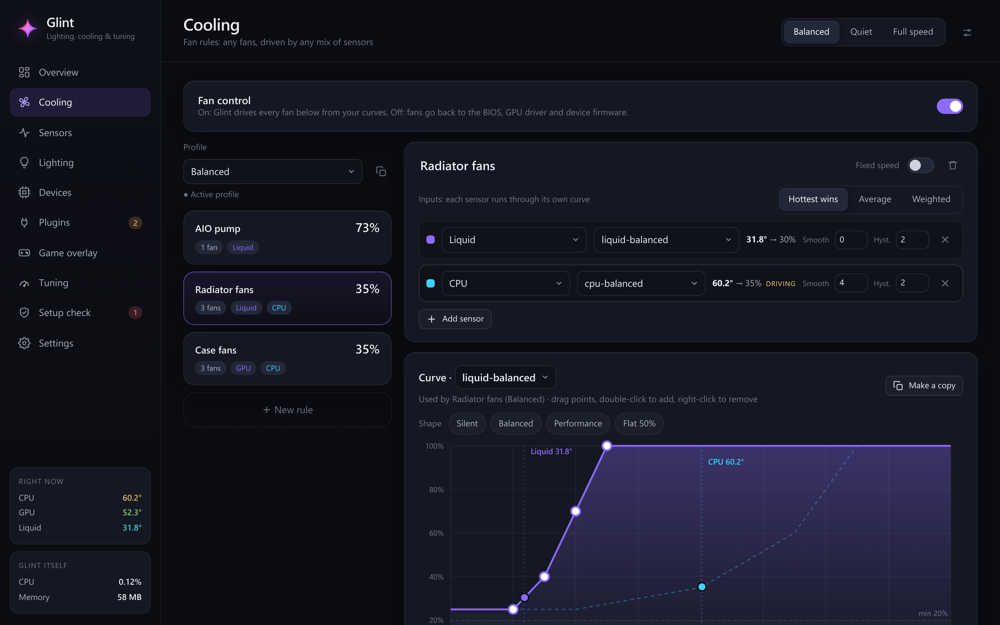 |
| **Overview**: temperatures, fans and lighting at a glance | **Cooling**: multi-sensor curves, profiles, live duty |
| 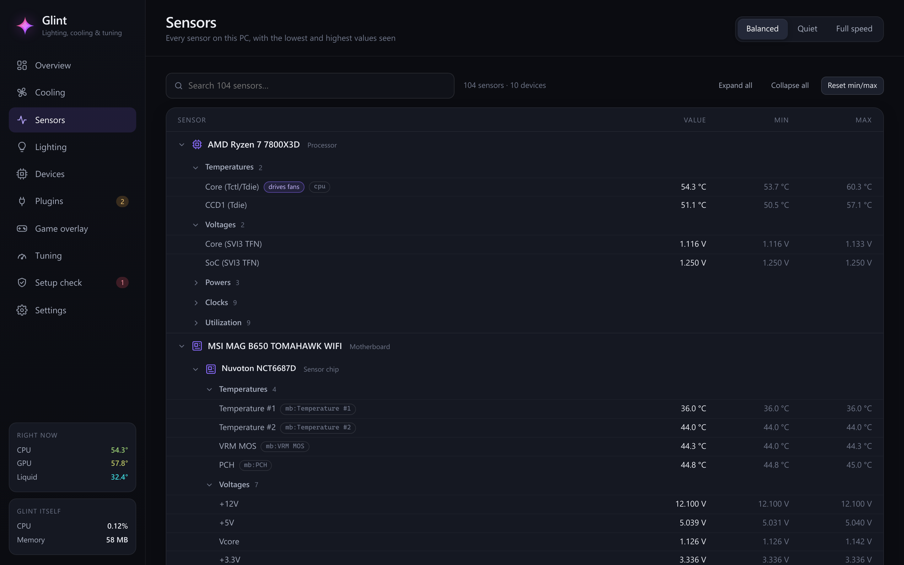 | 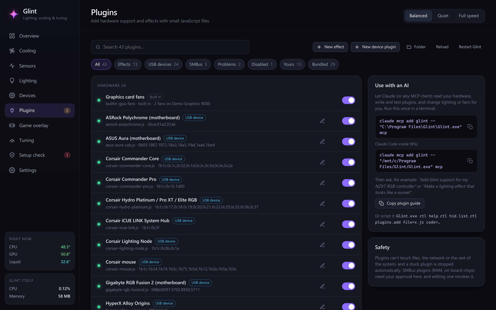 |
| **Sensors**: every sensor with min/max, HWMonitor-style | **Plugins**: search, enable, approve, write your own |
| 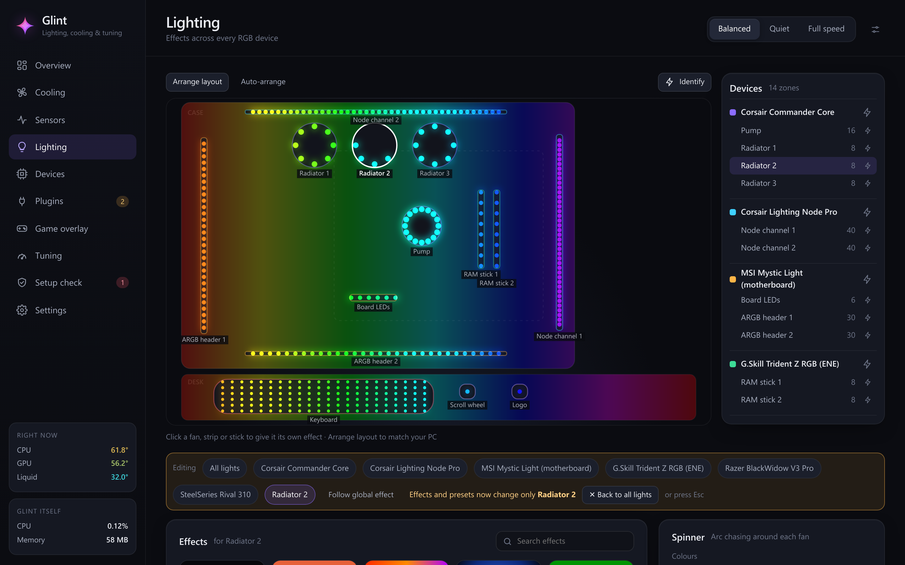 | 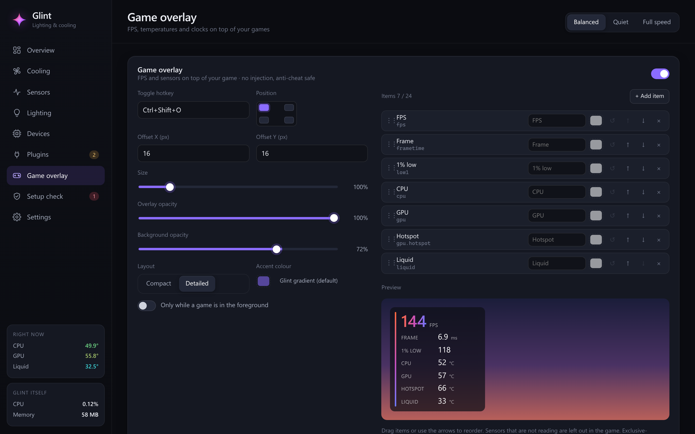 |
| **Per-device effects** on the layout canvas | **Game overlay**: pick any sensor, position, hotkey |
| 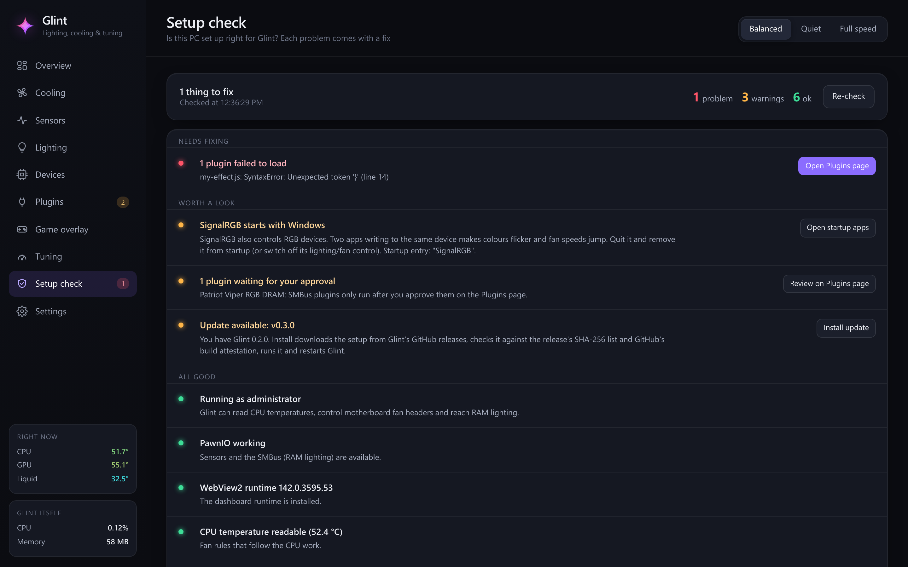 | 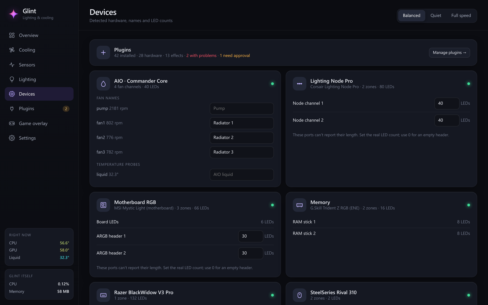 |
| **Setup check**: drivers, admin rights, conflicting apps, with fixes | **Devices**: names, LED counts and a test pattern |

## Install

Requirements: Windows 10/11 x64. Everything else (the .NET runtime, WebView2, PawnIO) is handled by the setup.

**Setup (recommended):** download `Glint-Setup-x.y.z.exe` from [Releases](../../releases) and run it. It installs to
`Program Files\Glint`, registers an elevated logon task (so Glint can read the hardware without a UAC prompt each
boot), adds a Start menu entry and starts Glint. Optional steps in the wizard:

- **PawnIO** (checked if missing): downloads the official signed driver from its
  [GitHub releases](https://github.com/namazso/PawnIO.Setup/releases) for CPU temperatures, motherboard fan headers and RAM lighting. If you're offline, setup continues and you can install it later from [pawnio.eu](https://pawnio.eu).
- **WebView2 runtime** (only if missing): downloads Microsoft's Evergreen runtime for the dashboard.
- **Disable SignalRGB at startup** (unchecked): stops it and removes it from startup (it doesn't uninstall it).

**Glint isn't code-signed yet**, so Windows SmartScreen may say *"Windows protected your PC"* the first time you run
the setup. Click **More info → Run anyway**. To check that your download is the one GitHub Actions built, compare
its SHA-256 hash with `SHA256SUMS.txt` on the same release page:

```powershell
Get-FileHash .\Glint-Setup-x.y.z.exe -Algorithm SHA256   # the Hash must match the line in SHA256SUMS.txt
```

Uninstall from Windows Settings > Apps; setup asks whether to also delete your settings in `%APPDATA%\Glint` (kept by default).
Silent install: `Glint-Setup-x.y.z.exe /VERYSILENT /SUPPRESSMSGBOXES /TASKS="pawnio,desktopicon"`.

**Portable / script install:** download `Glint-x.y.z-portable-win-x64.zip`, extract it, and run
`powershell -ExecutionPolicy Bypass -File install.ps1` (accept the admin prompt). It copies the bundled files and installs
[PawnIO](https://pawnio.eu) via winget. `install.ps1 -DisableSignalRgb` does the SignalRGB step, `install.ps1 -Uninstall` removes Glint (settings kept).

**From source:** see [CONTRIBUTING.md](CONTRIBUTING.md#building) (`dotnet build`, or `install.ps1` from a checkout).

Switching from another RGB app? Close it first: two programs driving the same device fight each other. The
**Setup check** page lists any that are running or set to start with Windows.

## ✅ Setup check

The **Setup check** page (sidebar, next to Settings) answers "is my PC set up right for Glint?" in one list. Each
item is ok / warning / problem, says in plain words what it means, and has a fix button where there is one:

- Glint running as administrator (needed for CPU temperatures, motherboard fans and RAM lighting) → *Restart as administrator*.
- PawnIO installed and working → *Get PawnIO*; WebView2 runtime version → *Get WebView2*; CPU temperature readable.
- Apps that drive the same hardware, running or set to start with Windows: SignalRGB, Corsair iCUE, ASUS Armoury
  Crate / LightingService, MSI Center / Mystic Light, NZXT CAM, Lian Li L-Connect, Razer Synapse, Logitech G HUB,
  OpenRGB (unless the OpenRGB bridge uses it) and FanControl → *Open startup apps*.
- Plugins waiting for approval or failing to load → *Plugins page*; devices whose plugin declined them.
- The startup task, Glint's version and whether an update is available, and the OpenRGB bridge.

It only runs when you open the page (or press **Re-check**); nothing polls in the background. The sidebar shows a red
count when something needs fixing, and the Overview shows a one-line banner for the important ones. Scripts and AI
agents get the same report from `Glint.exe ctl setup.check` / `glint_setup_check`.

## 🔄 Updates

Glint can tell you when a new version is out: one request to GitHub's `releases/latest` API for this repository
about 20 s after start and then once a day. Nothing else is sent. When there is a newer release you'll see *Update
available* on the Setup check page, in Settings and in the tray menu. Offline, or no release published: it stays
quiet. Switch it off in Settings (`updates.check`).

### Updating

Click **Install update** (Setup check page, Settings, or *Install update vX* in the tray menu). Glint shows
*downloading → verifying → installing*, then the setup runs silently, closes Glint and starts the new version. Your
settings, layouts, plugins and the choices you made in the setup (desktop shortcut, ...) are kept.

Before anything is run, Glint checks:

- it is a **newer** release of this repository (no pre-releases, no downgrades), downloaded only from this
  repository's GitHub release (and GitHub's own download servers);
- the setup's **SHA-256** matches the release's `SHA256SUMS.txt`;
- GitHub has a **build attestation** for exactly that file, made by this repository's release workflow for that
  version's tag, i.e. the file was built by GitHub Actions from the tagged source, not uploaded by hand;
- the file is still the same right before it starts (it is kept in a folder only administrators can write).

If any check fails nothing is run and Glint tells you why. Releases from before attestations were added can't be
installed this way; use the release page. You can verify any download yourself with
`gh attestation verify Glint-Setup-<version>.exe --repo jleeh/glint` (details in [SECURITY.md](SECURITY.md#updates)).

**Automatic install** (Settings, off by default, `updates.autoInstall`): installs a new release by itself, but only
after 10 minutes without keyboard/mouse input, with no game or fullscreen app in front, and not on battery; each
version is tried at most once a day. The portable version doesn't update itself: download the new zip.

## Supported hardware

Built-in device plugins (✅ = verified on real hardware; the rest are implemented from the open-source reference
drivers and pass their simulated-device tests. Reports from owners are very welcome!):

| Type | Devices |
|---|---|
| AIO / fan hubs | ✅ Corsair Commander Core / Core XT / Commander ST · Corsair Commander Pro · Corsair iCUE LINK hub · Corsair Hydro Platinum / Pro XT / Elite · NZXT Kraken X3 / Z3 (RGB) · NZXT HUE 2 / Smart Device V2 / RGB & Fan Controller · Lian Li Uni Hub (SL/AL V2, SL Infinity) |
| LED controllers | ✅ Corsair Lighting Node Pro / Core |
| Motherboards | ✅ ASUS Aura USB · MSI Mystic Light · Gigabyte RGB Fusion 2 · ASRock Polychrome USB |
| RAM | ✅ Corsair Vengeance / Dominator RGB (DDR4/DDR5) · G.Skill Trident Z and other ENE-based kits · Kingston Fury Beast / Renegade · Crucial Ballistix |
| Keyboards | ✅ Logitech G213 · Logitech G813/G815/G915 · Razer Chroma · SteelSeries Apex · HyperX Alloy Origins |
| Mice | Logitech G-series (HID++) · ⚠️ Logitech G402 (experimental) · Razer · SteelSeries Rival · HyperX Pulsefire · Corsair |
| Sensors & fan headers | CPU, GPU, motherboard Super I/O fan headers, graphics-card fans (NVIDIA / AMD; handed back to the driver when no rule drives them), drives, RAM, PSU, controllers via [LibreHardwareMonitor](https://github.com/LibreHardwareMonitor/LibreHardwareMonitor) |

Don't see yours? [Add it](#add-your-own-hardware) or [open a device request](../../issues/new?template=device-support.md).

## Resource use

Measured on a typical RGB desktop (AIO + fan hub, LED strips, motherboard, RAM and keyboard; ~500 LEDs):

| | CPU | Memory |
|---|---|---|
| Animated effect on every device at 30 fps | ≈ 1% of total CPU (most of it is USB/SMBus I/O) | ≈ 75–80 MB private |
| Static lighting (only keep-alives are sent) | ≈ 0.2% of total CPU | same |
| Dashboard closed | no browser processes at all | – |
| Game overlay hidden / visible | 0 / ≈ 0.3% of one core | +5 MB once shown |

## Add your own hardware

Glint was built so that adding a device is a single JavaScript file, and so that an AI can do most of the work:

1. Find your device's USB ID (Device Manager → Details → Hardware Ids) and an open-source driver for it
   (OpenRGB, liquidctl, OpenLinkHub or a Linux kernel driver).
2. Give both to your AI along with [`PLUGINS.md`](src/Glint/plugin-templates/PLUGINS.md), or connect your AI to
   Glint's MCP server and ask it: *"add support for my <device>"*. It can read the guide (`glint_plugins_docs`),
   list your USB devices (`glint_hid_list`), write the plugin (`glint_plugins_add`), run its simulated tests
   (`glint_plugins_check`) and flash it to find it (`glint_lighting_identify`).
3. Every plugin carries built-in tests: expected bytes from the reference driver, checked against a simulated
   device, so mistakes are caught before your hardware sees them.

```js
module.exports = {
  type: 'device', id: 'myhub', name: 'My RGB Hub',
  vendorId: 0x1234, productIds: [0x5678],
  init(dev)  { /* identify, return zones/fans or false */ },
  render(dev, rgb) { /* send one frame */ },
  poll(dev)  { /* optional: { temps, rpm } */ },
  setDuty(dev, duty) { /* optional fan control */ },
};
```

Plugins run sandboxed (no file, network or .NET access, memory and time limits). SMBus plugins (RAM and other
motherboard devices) can only touch the addresses they declare, must identify a device before writing, can never
touch the SPD EEPROM, and need your approval in the dashboard. Effect plugins add new looks to the gallery and
hot-reload on save. See [CONTRIBUTING.md](CONTRIBUTING.md) to share yours.

## 🤖 AI agents (MCP) and scripting

Point any MCP client at Glint (Claude Desktop, Claude Code, Cursor, ...):

```json
{ "mcpServers": { "glint": { "command": "C:\\Program Files\\Glint\\Glint.exe", "args": ["mcp"] } } }
```

**[docs/AI-GUIDE.md](docs/AI-GUIDE.md)** walks an AI through adding a device, writing an effect, tuning fans and building an overlay, with the safety rules. Coding agents working on Glint itself: see [AGENTS.md](AGENTS.md).

The same methods are available from a terminal: `Glint.exe ctl help`, e.g. `Glint.exe ctl lighting.preset name=Comet`.
Glint has a local control API (a named pipe only the current user can open). `Glint.exe ctl <method> [key=value ...]`
calls it from a terminal, and `Glint.exe mcp` serves every method as an MCP tool (`glint_<method>`) for AI agents.
`Glint.exe ctl help` lists everything. Cooling and config tools:

- `fans.list`: every profile's rules (fans, inputs, curves, min/max, ramps, override, live duty and RPM) plus
  the curves and the sensor ids usable as inputs.
- `fans.setRule` / `fans.removeRule`: create, update (partial fields merge) or delete a rule by name.
- `curves.set` / `curves.remove`: named curves (`[[tempC, duty%], ...]`); removing one that is in use is refused.
- `fans.override`: manual duty for a rule, or `null` for automatic. Clamped to the rule's min/max; the fail-safe still wins.
- `profiles.create` (copy of a profile) / `profiles.remove` (not the active one), `profile.set`.
- `config.schema`: every config field with type, range, default and example. `config.validate` checks a config without saving.
- `lighting.autoLayout` needs `confirm=true` because it overwrites a hand-tuned layout. The old layout is saved to
  `layout-backups\` in the config folder (last 10); `lighting.layoutBackups` and `lighting.restoreLayout` bring it back.

Every write (`config.set`, `config.patch` and the tools above) is validated first: unknown sensors or curves,
unsorted or out-of-range curve points, min > max, out-of-range brightness/fps, unknown effect types and a missing
active profile are rejected with `{ "ok": false, "errors": [...] }` and nothing is saved. Fans that aren't
connected right now only produce a warning.

## 🌀 Fan control

Each **rule** drives a set of fans from any number of **inputs**. An input is a sensor paired
with a curve. The inputs are combined by `Max` (the default: the hottest component wins),
`Average`, or `Weighted`.

```jsonc
{
  "fans": ["cc:fan1", "cc:fan2"],
  "inputs": [
    { "sensor": "gpu",    "curve": "gpu-balanced" },
    { "sensor": "cpu",    "curve": "cpu-balanced", "smoothingSec": 4, "hysteresis": 2 },
    { "sensor": "liquid", "curve": "liquid-balanced", "weight": 2 }
  ],
  "combine": "max", "minDuty": 20, "maxDuty": 100,
  "rampUpPerSec": 25, "rampDownPerSec": 4
}
```

- **Sensor IDs:** `cpu`, `gpu`, `gpu.hotspot`, `liquid`, `cc:probe1`, `mb:<name>`, or any
  LibreHardwareMonitor identifier. Expressions such as `max(cpu,gpu)` and `avg(a,b)` also work.
- **Fail-safe:** a missing or implausible sensor makes its input contribute `failsafeDuty` (100%).
  If Glint exits or crashes, the Corsair hubs go back to their firmware curves.
- **Profiles:** Balanced, Quiet and Full speed are built in. Switch them from the tray, or clone
  and edit them in the dashboard.

## 💡 Lighting

Effects: Static, Gradient, Breathing, Spectrum, Rainbow wave, Colour wave, Spinner, Marquee, Comet, Meteor rain,
Starfield, Fire, Plasma, Rain, Strobe, Temperature (follows a sensor), Audio spectrum and Beat pulse (system audio,
captured only while one is active), plus effect plugins.

- **Layout:** the Lighting page shows your PC (case + desk) as a canvas. Effects paint the canvas and each LED takes
  the colour where it sits, so a wave really sweeps across the whole rig. **Auto-arrange** makes a first guess from
  what each device is; **Arrange layout** lets you drag, resize and rotate; **Identify** flashes a device for real.
- **Per-device / per-zone effects:** click a device or fan to give it its own effect (Esc or click again to go back
  to all lights).
- **Presets** for all lights or the selected device, and from the tray menu.
- **LED counts:** ARGB headers and LED-strip channels can't report how many LEDs are connected. Set the count on the
  Devices page and switch on **Test pattern**: the first LED turns white, the last one red, and the colour changes
  every 8 LEDs (one fan's worth). The count is right when the red LED is the last one lit. The pattern follows what
  you type immediately and switches itself off after 60 s or when you leave the page; Glint then needs a quick
  restart for the device to use the new count.

## 🌈 OpenRGB bridge

For devices Glint has no plugin for yet, Glint can drive them through [OpenRGB](https://openrgb.org)'s SDK server
(off by default). In OpenRGB open the **SDK Server** tab and start the server, then in Glint's Settings switch on
**OpenRGB bridge** and restart Glint. Its devices then appear in Glint like any other (ids `orgb-…`): they take part
in effects, the layout canvas and per-device overrides, at up to 30 fps.

- Glint connects once at start-up to `127.0.0.1:6742` (configurable), negotiates the protocol version and puts each
  device in OpenRGB's custom (direct) mode.
- Devices Glint already drives itself are skipped (matched by USB VID/PID from OpenRGB's device location, else by
  name), so two drivers never fight over one device. Add more to **Leave these devices alone** in Settings.
- It's built into Glint, not a plugin: plugins have no network access by design.
- Config: `openRgb: { enabled, host, port, exclude }`. The Setup check page shows whether the bridge connected and
  which devices it took or skipped.

## 🎮 Game overlay

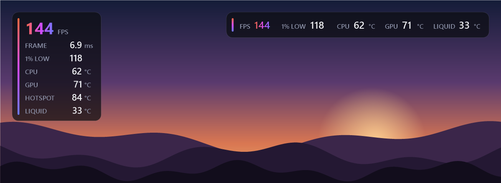

A small click-through overlay with FPS, frame time, 1% low and any sensor. Toggle it from the tray menu
(**Game overlay**), with **Ctrl+Shift+O**, or with `ctl overlay.toggle`.

- **No injection.** FPS comes from the same Windows ETW present events PresentMon uses
  (Microsoft-Windows-DXGI and Microsoft-Windows-DxgKrnl), counted for the foreground window's process. Nothing is
  hooked and no game memory is read, so it is safe with anti-cheat. The ETW session (`Glint-Overlay`) only runs
  while the overlay is on screen. When the overlay is off, nothing runs at all.
- **1% low** is the frame rate at the 99th-percentile frame time over the last ~10 s.
- The window is borderless, click-through, topmost, never takes focus and stays out of Alt-Tab. It follows the
  monitor of the foreground window and scales with its DPI. It redraws only when the text changes (at most 4 times a second).
- **Exclusive-fullscreen games may not show it.** Borderless and windowed modes do.
- Settings live in the `overlay` section of the config (`overlay.get` / `overlay.set`, validated): `position`
  (`top-left` … `bottom-right`), `offsetX`/`offsetY`, `scale`, `opacity`, `backgroundOpacity`, `accent`,
  `layout` (`compact` or `detailed`), `onlyWhenGame` (fullscreen / borderless-fullscreen apps only), `hotkey`, and
  `items`: an ordered list of `{ "source", "label"?, "color"? }`. A source is `fps`, `frametime`, `low1`, `time`,
  `glint.cpu`, `fan:<id>` (RPM), `duty:<id>` (%), or a sensor id (`cpu`, `gpu`, `gpu.hotspot`, `liquid`, ...).
  Sensors that aren't reading are left out.
- `overlay.stats` returns the live FPS, frame time, 1% low and target process.

## 📊 Sensors

The Sensors page lists every sensor LibreHardwareMonitor can see (temperatures, voltages, clocks, loads, power,
fans, data, throughput) with value, min and max, grouped by hardware, with search. The full scan only runs while
the page is open; AI agents get the same tree from `glint_sensors_all`.

## 🏠 Home Assistant

Glint can publish to Home Assistant over MQTT. HA's MQTT discovery creates the entities automatically.
Nothing runs until it is enabled.

**Setup**

1. In Home Assistant, install the **Mosquitto broker** add-on (Settings → Add-ons) and start it. Then add the
   **MQTT** integration (Settings → Devices & services); it finds the add-on by itself. Create a Home Assistant
   user (or a Mosquitto login) for Glint to connect as.
2. In Glint, enable it in **Settings**, or from a terminal:

   ```jsonc
   // ha.json
   { "enabled": true, "host": "homeassistant.local", "port": 1883, "tls": false,
     "username": "glint", "password": "…", "discoveryPrefix": "homeassistant", "baseTopic": "glint" }
   ```

   `Glint.exe ctl config.patch path=homeAssistant value=@ha.json`, then check it with `Glint.exe ctl ha.status`.

The password is never stored in plain text. Glint encrypts it with Windows DPAPI for the current user and
saves the result as `passwordProtected`. A plain `password` (from the dashboard, the API or a hand edit)
is converted on the next save or load. Use `"tls": true` and port 8883 for an encrypted broker connection.
Changing other settings doesn't reconnect; only changes to the `homeAssistant` section do.

**Entities** (one device, "Glint (<PC name>)")

| Entity | What it does |
|---|---|
| `sensor` per temperature | Every friendly sensor (cpu, gpu, liquid, hub probes, board, disks…), in °C. Uses your sensor names. |
| `sensor` per fan | Speed (RPM) and duty (%). Uses your fan names. |
| `sensor` Glint CPU usage | Glint's own CPU use, as % of one core. |
| `light` RGB | On/off (lighting enabled), brightness, an RGB colour (sets a static colour on all lights), and effects (your lighting presets). Colour and effect changes clear per-device overrides, as the dashboard does. |
| `light` per lighting device | One per device (e.g. `aura`, `kbd`). Writes `lighting.overrides[<device id>]`. Colour sets a solid colour, and brightness scales that colour. Effect is a preset, or **Follow global** to remove the override. Off sets a static black override. |
| `fan` per fan rule | One per rule in the active profile, named after the rule. Setting a percentage stores a manual override (`override` on the rule, so it shows in the dashboard and survives restarts). The value is clamped to the rule's min/max duty, so pumps never go below their minimum. Preset **auto** returns the rule to its curves, and "off" holds the minimum. The fail-safe still wins: a lost sensor or a curve at the fail-safe duty sends the fans to 100%. |
| `select` Fan profile | Switches the active fan profile. |
| `button` Identify *device* | Flashes that lighting device on the real hardware. |

Example HA script: keyboard red, radiator fans at 80%, then back to automatic after an hour. Entity ids
follow your PC, device and rule names; check them in HA under the Glint device.

```yaml
script:
  pc_red_alert:
    sequence:
      - action: light.turn_on
        target: { entity_id: light.glint_my_pc_keyboard }
        data: { rgb_color: [255, 0, 0], brightness: 255 }
      - action: fan.set_percentage
        target: { entity_id: fan.glint_my_pc_radiator_fans }
        data: { percentage: 80 }
      - delay: "01:00:00"
      - action: fan.set_preset_mode
        target: { entity_id: fan.glint_my_pc_radiator_fans }
        data: { preset_mode: auto }
```

Sensor states are sent at most every 5 s, and only when a value has moved enough to matter (0.5 °C,
50 RPM, 1 %). Everything is refreshed every 60 s. Light and profile changes are sent as they happen.
Commands from HA go through the same path as the dashboard, so config.json and the dashboard stay in sync.
Availability uses an MQTT last will: entities show *unavailable* when Glint exits or the PC goes down.
When HA restarts, Glint publishes discovery again. Topics: discovery under `<discoveryPrefix>/…/config`,
state under `<baseTopic>/<pc-name>/…`, and commands under `<baseTopic>/<pc-name>/cmd/…`.

## Building from source

```powershell
dotnet build src/Glint/Glint.csproj -c Release
src\Glint\bin\Release\net10.0-windows\Glint.exe selftest selftest.json   # offline checks (simulated devices)
src\Glint\bin\Release\net10.0-windows\Glint.exe plugincheck all          # every plugin's built-in tests
powershell -ExecutionPolicy Bypass -File install.ps1                      # install + start
```

More test commands:

- `Glint.exe selftest out.json --hw`: real hardware checks (run elevated via the "Glint selftest" scheduled task).
- `Glint.exe controltest out.json`: the control API / MCP methods against a private test pipe and config.
- `Glint.exe webtest out.json`: the real WebView2 dashboard off-screen.
- `node tools/uitest.js <absolute path to src/Glint/web/index.html> out.json`: the dashboard against a fictional demo
  rig in headless Chrome (`CHROME_PATH` to point at Chrome); `node tools/screenshots.js` regenerates these screenshots.
- `Glint.exe overlaybench out.json` / `etwsmoke out.json` (elevated): overlay cost and a 3 s ETW present-event check.

Settings live in `%APPDATA%\Glint\config.json` (hot-reloads on save). The dashboard, tray, CLI, MCP and Home
Assistant all edit the same file through the same validation.

## Credits & license

Glint is licensed under the [GNU GPL v3.0](LICENSE). Device protocols were learned from
[OpenRGB](https://gitlab.com/CalcProgrammer1/OpenRGB), [liquidctl](https://github.com/liquidctl/liquidctl) and
[OpenLinkHub](https://github.com/jurkovic-nikola/OpenLinkHub); sensors come from
[LibreHardwareMonitor](https://github.com/LibreHardwareMonitor/LibreHardwareMonitor) and
[PawnIO](https://pawnio.eu). Full list in [NOTICE.md](NOTICE.md).

Glint is not affiliated with any hardware vendor. Product names are trademarks of their owners. Lighting and fan
control talk directly to hardware: use at your own risk, and keep the fail-safes on.
